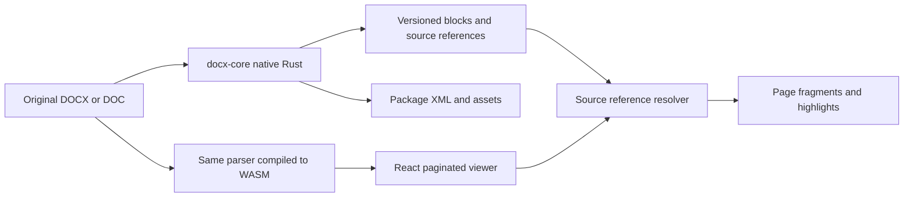

# Structured DOCX/DOC blocks and viewer geometry

The shared Rust parser owns content identity. The browser owns the geometry of the pages it renders. Extend can persist parser output without a browser, then use the same source references to highlight the original document in React.



## Contract

`parse_document_blocks(bytes)` in Rust and `extractDocumentBlocks(model)` in TypeScript return the same JSON contract. It contains `schemaVersion`, `parserVersion`, `documentId`, hierarchical `blocks`, diagnostics, and `geometryStatus: "requires_layout"`.

The document ID hashes sorted uncompressed XML strings and asset bytes. It does not hash ZIP compression or ordering. Keep the original upload hash alongside it. A source reference contains the document ID, part name, story, and node ID. IDs are deterministic for a fixed document and parser version. Persist them; do not reconstruct them from displayed text. Pin native and WASM parser builds together. Imported anchors describe one document version; after editing and saving, parse the saved bytes as a new version.

Each paragraph carries styled inline text with UTF-16 offsets. Inline references preserve the positions of child figures, equations, and controls. Tables retain row/column indexes, grid spans, row spans, cell properties, nested tables, and child paragraphs. Header/footer containers retain their children's original types. Notes and comments use their own stories and source identities.

Container content is a summary of descendants, not another independent occurrence of that text. Avoid counting both table summaries and cell text during downstream extraction. A text box is a figure containing addressable paragraphs/tables. A form control is a `key_value` block with its imported control definition. Paragraph text, field instructions, hyperlinks, style and numbering metadata remain available.

Empty text paragraphs and empty cells are omitted from block output without changing the layout model or its source IDs. Empty paragraph wrappers promote their meaningful children. Blank figures, equations, barcodes, watermarks, and form controls remain addressable. Table row/column counts, indexes, and merged-cell spans retain their original values after filtering.

All existing Extend block type names are represented by the shared enum:

| Extend type | DOCX representation |
| --- | --- |
| `text` | Paragraph content, including note and comment stories |
| `heading` | Resolved heading level |
| `section_heading` | Title/subtitle style |
| `figure` | Image, drawing, chart preview, or text-box container |
| `table` | Table container |
| `table_head` | Explicit repeating header row |
| `table_cell` | Addressable cell with grid indexes and spans |
| `key_value` | Form control and imported value |
| `page_number` | Paragraph identified by a page-number field |
| `barcode` | Explicit barcode field or typed barcode image |
| `formula` | OMML equation with MathML and source markup |
| `header`, `footer` | Reusable story containers |
| `watermark` | Explicitly typed watermark; generic background art remains a figure |
| `legend` | Caption style |

These are mappings, not predictions of information absent from the document. Numbered lists retain numbering metadata; no separate list type is required. A printed key/value pair is not inferred to be a form control. Image text requires OCR. Barcode generation/decoding and semantic chart/diagram interpretation are separate capabilities.

## Viewer API

```tsx
const output = await extractDocumentBlocks(model);
const block = output.blocks[0];
const geometry = resolveDocxSourceGeometry(viewerRoot, block.sourceRefs);
const pageBlocks = toDocxPageBlocks(block, geometry);

<DocxBlockHighlights rootRef={viewerRootRef} block={selectedBlock} />

const flat = flattenDocumentBlocks(output.blocks);
const geometries = resolveDocxBlockGeometries(viewerRoot, flat);
const extendBlocks = toExtendParserBlocks(output.blocks, geometries);

<DocxBlockHighlights rootRef={viewerRootRef} blocks={flat} block={selectedBlock} />
```

Wrap the viewer in an element referenced by `viewerRootRef`. The resolver measures the actual DOM used by the viewer, including table cells, nested paragraphs, drawings, live text boxes, equations, notes, and header/footer content where mounted. It clips through layout containers and returns one or more page fragments in unzoomed page CSS pixels. It does not run the separate layout-snapshot renderer.

A fragment contains a zero-based page index, page dimensions, rectangle, and polygon. `normalizedDocxBoundingBox` produces fractional page coordinates for overlay consumers. `toDocxPageBlocks` adds the page metadata, polygon, and bounding box shape used by Extend, with a one-based page number and a page-specific occurrence ID. `sourceBlockId` and `sourceRefs` retain the logical identity across pages. The original fragment list remains available rather than collapsing cross-page geometry into one rectangle.

`toExtendParserBlocks` produces the nested Extend parser shape, including its detail discriminators, per-page parent/child relationships, and **72-point page coordinates**. The resolver and `toDocxPageBlocks` use **96-DPI CSS pixels**. Source-specific styles, spans, controls, and MathML remain in `sourceDetails`. A formula without a LaTeX representation has empty Extend `details`; its MathML is preserved, never mislabeled as LaTeX. Unresolved/unmounted blocks are absent from this geometry projection and remain in the semantic source output.

`DocxBlockHighlights` refreshes on DOM changes, page sizing, font completion, scrolling, and zoom. Geometry is scoped to **mounted pages**. `rendered` means the supplied source references resolved on those pages; it is not proof that every occurrence of a repeated header or split block is mounted. `revealDocxSource` scrolls to an existing fragment or asks the viewer to mount the relevant body/table page.

Unresolved references produce explicit statuses/issues, never a zero-size placeholder box. Comments rendered in an external sidebar have no page rectangle. Deleted or hidden content may have no visible fragment. Character-range references currently return `unsupported_range`; block-level geometry is supported. Tight glyph polygons for rotations and transformed text are not provided; rectangles are axis-aligned.

## Playground

Enable **Blocks** in the toolbar. The inspector uses Extend's 15 type names and highlight colors, shows table dimensions and cell indexes/spans, and offers a type filter with counts. Turn on **Show all highlights** to outline every mounted block matching that filter, including individual table cells. Hover or focus a row to emphasize its fragments; click to reveal it and retain selection. The JSON button includes the selected block's current geometry. Download exports the nonempty semantic block result without pretending browser coordinates are permanent parser data. Disable Blocks to remove the panel and overlays.

**Formatted** shows complete block text, retained run styling (bold, italic, underline, strike, all caps, small caps, highlight, color, font, size, and subscript/superscript), links, table structure, and equations. **Markdown** shows the complete source representation, using HTML for formatting that Markdown cannot express. Neither mode truncates block text. Capitalization remains a presentation property: original text and UTF-16 source offsets are preserved. These previews use the imported styles; they do not reproduce every Word typographic effect.

Figures resolve their source IDs against the loaded model's embedded images, including assets inside tables and auxiliary stories. The formatted preview respects crop, opacity, and image filters. Alt text remains the accessibility label; unavailable image formats produce an explicit fallback. Markdown retains an image reference to the package asset path. Persist or serve the associated assets when consuming that Markdown outside the playground. Text boxes show their structured child content.

## Extend integration

1. Add the native `docx-core` dependency to Extend's Rust/N-API package and expose parsing through the existing native worker boundary. Retain the original upload, package assets, parser version, upload hash, and source references.
2. Replace the Mammoth HTML/chunk conversion with the structured tree. Use block/source identity for extraction citations; source paragraphs and images can participate in chunks without assigning fake physical page numbers.
3. Add a DOCX source-reference variant beside the existing HTML byte anchor. Preserve DOCX details as typed extensions: MathML is not LaTeX, and form controls and merged-cell spans carry information beyond current Extend detail schemas.
4. Update Extend's viewer dependency and pass citation source references to the public geometry/highlight APIs. Share its existing page overlay UI through normalized rectangles. Parser block type names remain unchanged.
5. When physical page geometry must exist on the backend, run the matching renderer with pinned fonts, browser, layout options, and document version, materialize all pages, and persist that render fingerprint with the geometry. Rust parsing alone cannot determine browser or Word page breaks.

The `docx-core` crate can be consumed from this workspace or a pinned Git revision now. Registry publication and changes to Extend's application are separate deployment steps.

## Coverage and remaining work

The optional `inspectDocumentSource(bytes)` / `document_source_graph(package)` API exposes XML structure, namespaces, attributes, text, comments, processing instructions, and an asset manifest. Original XML and bytes remain in the package. Unknown extensions remain inspectable. For DOC, this graph represents the OOXML adapter output; preserve the original binary upload for structures the adapter does not interpret.

Recognized imported HTML, subdocuments, embedded objects/controls, and diagrams are diagnosed as preserved-only. Equation rendering is diagnosed as approximate. Dynamic field evaluation, all floating/grouped drawing content, comprehensive revision views, encrypted/older DOC formats, imported HTML rendering, OCR, source-range geometry, and complete Word typography/pagination remain outside demonstrated parity. The diagnostics are not an exhaustive OOXML feature audit.

The acceptance targets are independent: content retention, semantic structure, stable references across runtimes, correct geometry in our viewer, and visual/page-break parity with Word. Passing one does not establish the others. The latest browser sample compares against previously captured, source-bound native references. Native investigation resumed, but the current Word installation requires activation for Save As exports; successful read-only page-count controls do not supply new PDF geometry references.

Validation artifacts for this implementation are in the ignored `output/playwright/structured-blocks/` directory. They include upstream Mammoth fixtures, focused semantic checks, the retained 1,000-document parser comparison, native/WASM legacy DOC results, browser corpus/local samples, interaction checks, and playground screenshots. The parser corpus and browser layout sample are separate acceptance checks.

### Recorded verification

- All 1,000 retained corpus documents parsed and produced unique, document-bound block IDs.
- Mammoth 1.12.0 parsed 997 of those inputs. Of these, 758 matched after whitespace normalization, 177 differed only in whitespace, 30 retained all paragraph text in a different order, and 32 retained Mammoth's text with additional content. The three Mammoth errors were checked separately and parsed successfully here. This is content-retention evidence, not a full semantic or rendering equivalence claim.
- All 17 upstream Mammoth DOCX fixtures matched normalized body text. Fifteen focused checks covered rich text, UTF-16 offsets/encoding, strict namespaces, relocated parts and round trip, notes/comments, header/footer types, line breaks, and source preservation.
- Eight legacy DOC fixtures produced identical native Rust and shipped CJS/WASM block results.
- The selected existing suites passed 85 Rust and 39 TypeScript tests. Workspace type checking and the library/playground builds passed.
- Browser checks covered table/cell, heading, equation and figure rectangles, zoom, later-page navigation, selection JSON, disabling highlights, a paragraph split over five pages, and header/footer/page-number/footnote fragments. Formatted/Markdown checks also cover combined text styling, unstyled runs, untruncated long text, embedded images, cropping, and floating-image hover anchors.
- The 100-document browser corpus sample rendered 807 pages and resolved 58,852 block fragments. Resolved rectangles were finite and within their pages, all had matching overlays, and the Extend projections passed coordinate/hierarchy checks. Some source blocks remain unresolved or invisible; this is not complete bounding-box coverage.
- Page counts matched the frozen native Word reference for 69 of 100 sampled documents. Of 96 native boundaries in the text-qualified subset, 77 had unique text anchors and 36 matched the browser break. Only three of 28 qualified documents matched complete per-page normalized text. Word pagination parity remains incomplete.
- After correcting nested text-box image rendering, delayed image-load observation, and mixed page/paragraph drawing origins, nine corpus documents resolved all 308 figures across 120 viewer pages. No figure rectangles or overlays were missing or invalid; page counts were unchanged. Separate edit/read-only and 100%/90% zoom checks passed. This establishes coverage for those figures, not complete document geometry or Word layout parity.
- An additional browser sample of 18 local DOCX and six local DOC files rendered 508 pages and resolved 16,060 block fragments. All resolved fragments passed the rectangle/overlay/Extend checks; 60 source blocks remained unresolved or invisible. No native Word reference was available for those local sample comparisons.
- The figure-preview change passed the playground type check and production build, the library build, and 48 existing image-related tests. Browser checks confirmed embedded PNG previews, cropped figures, TIFF conversion in a footer, and figure hover/show-all highlights.
